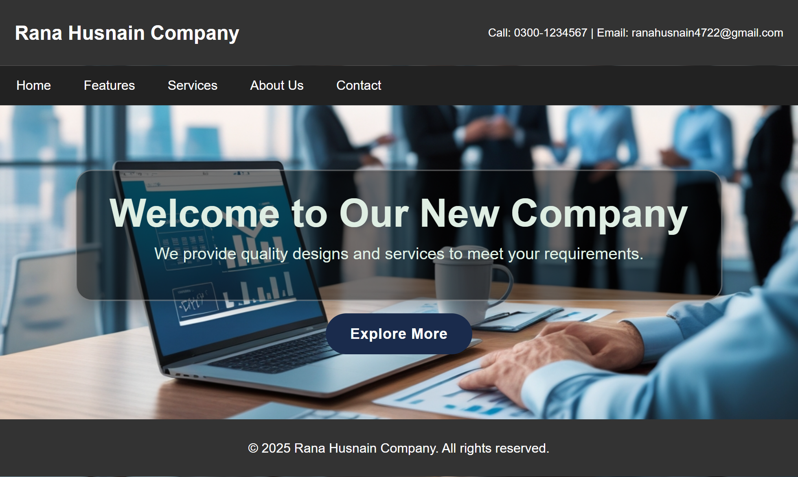

# Company Website Homepage

A static company website homepage built with HTML5 and CSS3 as part of my BSCS coursework at GIFT University.

## Features

- Header with contact details
- Navigation menu
- Hero section with background image and call-to-action button
- Navigation hover effects
- Footer section

## Tech Stack

- HTML5
- CSS3

## Screenshot

## Learning Context

This project was built during my first semester at GIFT University. I have since completed four semesters of my BS Computer Science degree and continue to build more advanced projects.